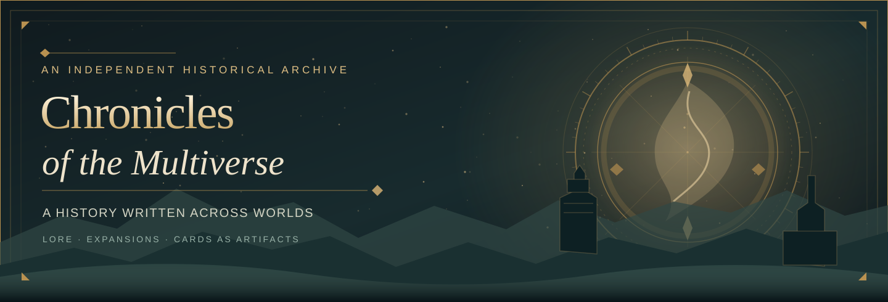
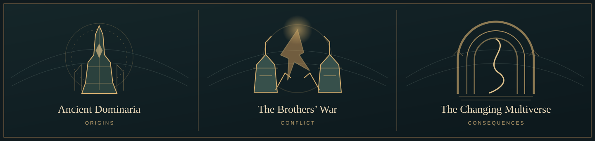
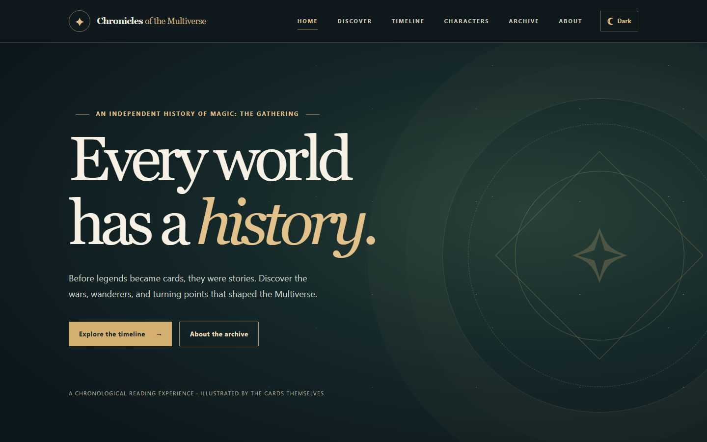
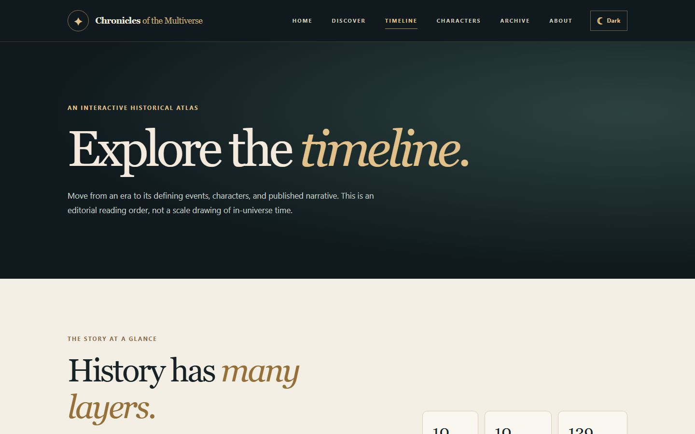
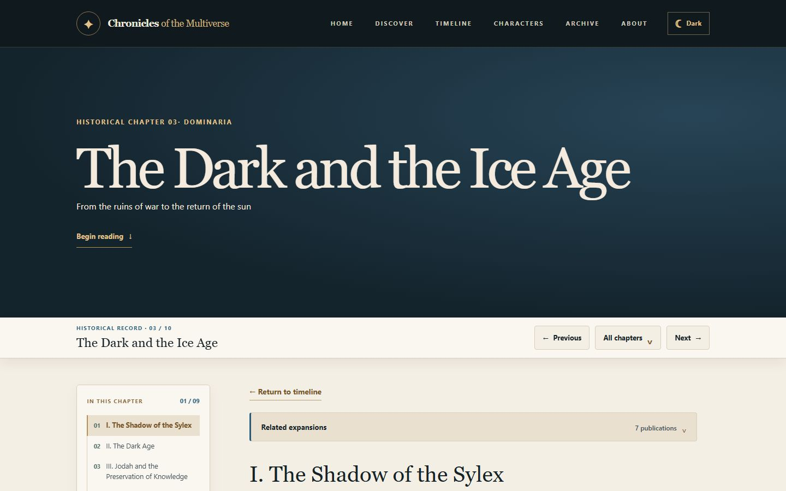
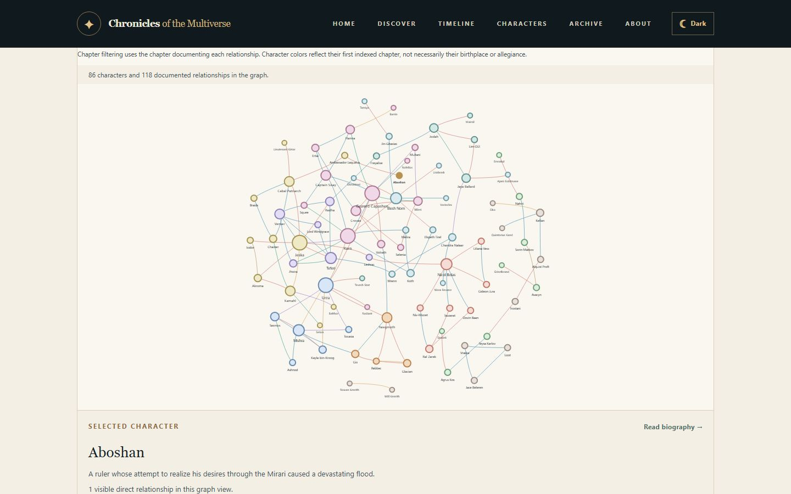
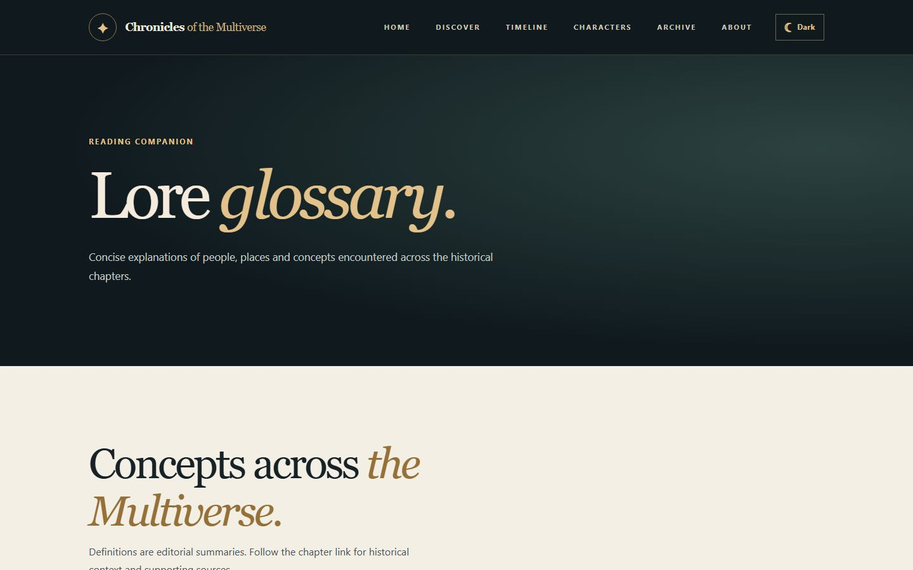
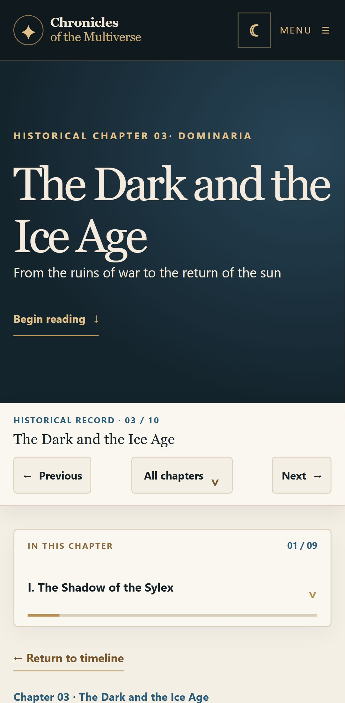

<p align="center">
  
</p>

<p align="center">
  <strong>History before everything.</strong><br />
  Follow the wars, discoveries, characters, and turning points that shaped the Multiverse — through the cards that remember them.
</p>

<p align="center">
  <a href="https://devisola.github.io/mtg-history/"><strong>Enter the archive</strong></a>
  &nbsp;·&nbsp;
  <a href="https://devisola.github.io/mtg-history/timeline/">Explore the timeline</a>
  &nbsp;·&nbsp;
  <a href="https://devisola.github.io/mtg-history/about/">About the project</a>
</p>

---

## The archive

**Chronicles of the Multiverse** is an independent, non-commercial historical reading project about the lore of *Magic: The Gathering*. It's designed as an illustrated chronicle, **not a card database or deckbuilding guide**.

Magic's history has been told across decades of expansions, novels, short fiction, and flavor text. This project connects those scattered sources into readable chapters, with selected cards acting as **historical artifacts**: illustrations and references that bring each event into focus.

<p align="center">
  
</p>

## Explore the history

| Follow the story                                                                                                                                                      | Discover its sources                                                                                                |
| :-------------------------------------------------------------------------------------------------------------------------------------------------------------------- | :------------------------------------------------------------------------------------------------------------------ |
| **[Historical timeline](https://devisola.github.io/mtg-history/timeline/)** — Follow historical eras in story order. | **[Characters](https://devisola.github.io/mtg-history/characters/)** and **[events](https://devisola.github.io/mtg-history/events/)** — Browse canonical historical records. |
| **[Illustrated chapters](https://devisola.github.io/mtg-history/chapters/brothers-war/)** — Read the narrative with exact card printings and editorial significance. | **[Relationship explorer](https://devisola.github.io/mtg-history/relationships/)** — Explore family, mentorship, alliance, and conflict links. |
| **[Discovery](https://devisola.github.io/mtg-history/discover/)** — Find connected people and turning points. | **[Lore glossary](https://devisola.github.io/mtg-history/glossary/)** — Define recurring concepts with chapter links. |

## Site previews

Screenshots below are **captured from the built site** in Chromium, not concept art. Run the reproducible capture command under [Screenshot workflow](#screenshot-workflow) before committing this README update; the image files are intentionally generated locally and must be added to the PR.

<table>
<tr>
  <td width="50%"><br /><strong>Archive homepage</strong></td>
  <td width="50%"><br /><strong>Historical timeline</strong></td>
</tr>
<tr>
  <td><br /><strong>Illustrated chapter</strong></td>
  <td><br /><strong>Character relationships</strong></td>
</tr>
<tr>
  <td><br /><strong>Lore glossary</strong></td>
  <td><br /><strong>Mobile chapter view</strong></td>
</tr>
</table>

### Two chronologies, one story

> **Story chronology** tracks when an event took place _inside_ the fictional Multiverse. **Publication chronology** tracks when Magic players first encountered, or later revisited, that event.

The Brothers' War, for example, appeared through the artifacts of _Antiquities_ (1994), was developed extensively in fiction, and returned in _The Brothers' War_ (2022). Our chapters connect those perspectives without confusing release dates with in-world history.

## How a chapter is built

Each article aims to provide:

1. **Historical context** — what led to the event and why it matters.
2. **The narrative** — key people, places, conflicts, and consequences.
3. **Illustrated evidence** — a small, carefully chosen selection of relevant cards.
4. **Publication history** — expansions and stories that reveal or revisit the event.
5. **Sources and connections** — references, uncertainties, and links to related chapters.

The writing is original. Official lore is prioritized, and retcons or uncertain chronology are identified rather than quietly presented as settled fact.

## Behind the archive

|                     |                                            |
| :------------------ | :----------------------------------------- |
| **Framework**       | [Astro](https://astro.build/) + TypeScript |
| **Styling**         | Dart Sass / Astro-scoped SCSS and design tokens |
| **Content**         | MDX and typed Astro Content Collections (cards, characters, events, relationships, glossary) |
| **Package manager** | pnpm                                       |
| **Hosting**         | GitHub Pages                               |
| **Deployment**      | GitHub Actions, with Playwright and content integrity checks |

This is a statically generated site: no accounts, database, or application server are required.

### Run locally

Requires **Node.js 22.12+**, **pnpm**, and Git.

```bash
git clone https://github.com/DevIsola/mtg-history.git
cd mtg-history
pnpm install
pnpm dev
```

With Astro's configured base path, open `http://localhost:4321/mtg-history/`.

```bash
pnpm run verify               # Unit, content, editorial, type, build and link gates
pnpm exec playwright test     # Desktop and mobile Chromium regression tests
pnpm preview                  # Preview the production build
```

Pushing a reviewed change to `main` triggers the existing GitHub Pages deployment workflow. The application stays static and does not rehost Scryfall card artwork.

### Screenshot workflow

The screenshot gallery is intentionally reproducible: Chromium renders the local production preview at desktop and mobile sizes. Captures use reduced motion and a fixed viewport. Screenshots should be recaptured whenever the visual design changes.

```powershell
pnpm install
pnpm exec playwright install chromium
pnpm run screenshots:readme
# Review docs/screenshots/*.jpg, then git add docs/screenshots
```

This writes six JPEGs under `docs/screenshots/`. Card imagery loaded from Scryfall belongs to its respective artists and rights holders; screenshots illustrate site functionality and are not an artwork redistribution library. See [docs/readme-screenshots.md](docs/readme-screenshots.md) for capture and review expectations.

## Current chapter of the project

**Under active development.** The timeline and chapter system establish the reading experience; historical articles, imagery, source references, and cross-links are being expanded incrementally.

Ten published chapters currently span the ancient Thran, the Brothers' War, Dominaria's Ice Age, the Weatherlight and Otaria eras, the Mending, stories across other worlds, the War of the Spark, March of the Machine, and the Omenpaths era. Canonical cards and characters are managed through typed collections, while artwork fidelity, source provenance and accessible interactions are checked in the engineering pipeline. More editorial depth and coverage are ongoing work.

## Support the archive

Chronicles of the Multiverse is a free, independent fan project
created and maintained by DevIsola.

If you enjoy the historical research, original writing, and
development that goes into this archive, you can support my work
through Ko-fi.

Your support helps me dedicate more time to expanding the
chapters, improving the reading experience, and maintaining
the project.

**Donations are entirely optional. All historical content
remains free to read and explore.**

<p align="center">
  <a href="https://ko-fi.com/B1H328PBAR">
    
  </a>
</p>

## Curated by DevIsola

Created and maintained by **[DevIsola](https://github.com/DevIsola)** as an independent, open-source tribute to the storytelling of Magic: The Gathering.

[Visit the live archive](https://devisola.github.io/mtg-history/) · [Explore the source](https://github.com/DevIsola/mtg-history)

---

<sub>**Unofficial fan-content notice.** This project is not affiliated with, sponsored, endorsed, or approved by Wizards of the Coast. Magic: The Gathering, its characters, settings, card art, and associated marks belong to their respective rights holders. This non-commercial archive uses original writing and original decorative README artwork and screenshots of the published site. Card images displayed within screenshots remain the property of their respective rights holders. See the <a href="https://company.wizards.com/en/legal/fancontentpolicy">Wizards of the Coast Fan Content Policy</a>.</sub>
