<p align="center">
  
</p>

<p align="center">
  <strong>History before everything.</strong><br />
  Follow the wars, discoveries, characters, and turning points that shaped the Multiverse — through the cards that remember them.
</p>

<p align="center">
  <a href="https://devisola.github.io/mtg-history/"><strong>Enter the archive</strong></a>
  &nbsp;·&nbsp;
  <a href="https://devisola.github.io/mtg-history/timeline/">Explore the timeline</a>
  &nbsp;·&nbsp;
  <a href="https://devisola.github.io/mtg-history/about/">About the project</a>
</p>

---

## The archive

**Chronicles of the Multiverse** is an independent, non-commercial historical reading project about the lore of *Magic: The Gathering*. It's designed as an illustrated chronicle, **not a card database or deckbuilding guide**.

Magic's history has been told across decades of expansions, novels, short fiction, and flavor text. This project connects those scattered sources into readable chapters, with selected cards acting as **historical artifacts**: illustrations and references that bring each event into focus.

<p align="center">
  
</p>

## A tour of the archive

Every image below is a screenshot of the real, built site, captured automatically by Playwright with the card artwork loaded live from Scryfall. See [how they are made](#screenshot-workflow).

<p align="center">
  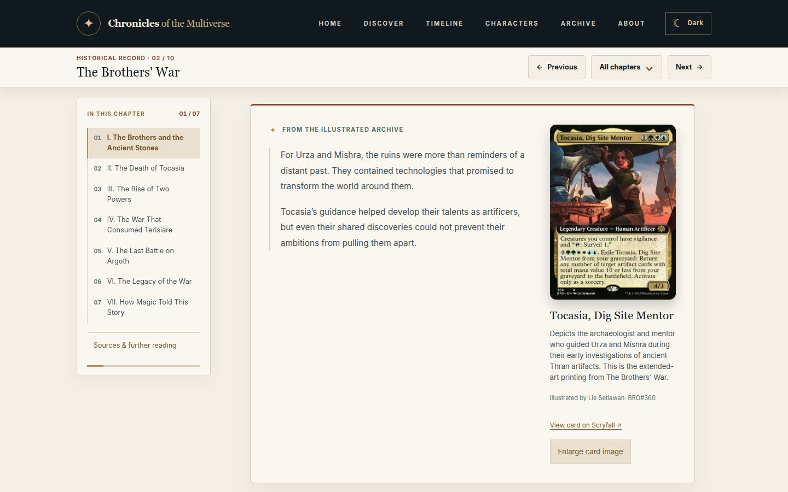
</p>

### Read history, illustrated by the cards that remember it

**[Ten illustrated chapters](https://devisola.github.io/mtg-history/chapters/thran/)** run from the Thran to the Omenpaths. Inside the narrative, *historical moments* set an exact card printing beside the passage it illustrates. Each one comes with its artist, set and collector number, and a note on what the card does and does not depict. A sticky table of contents tracks your progress through the chapter.

<table>
<tr>
  <td width="50%">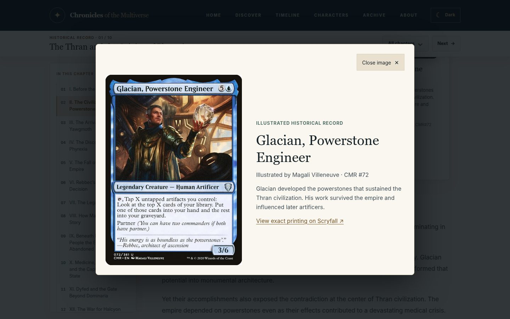</td>
  <td width="50%">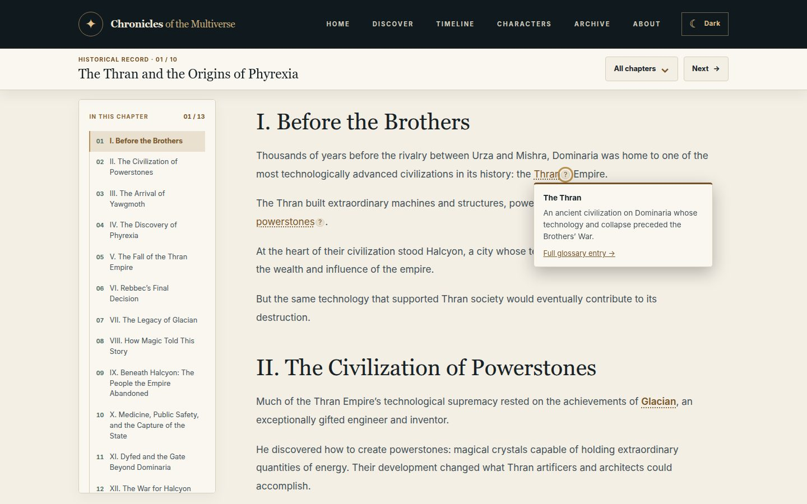</td>
</tr>
<tr>
  <td><strong>Artwork viewer.</strong> Enlarge any card to see the exact printing, its illustrator and its historical significance, with a link to Scryfall. Escape and focus return work as expected.</td>
  <td><strong>Lore on demand.</strong> Glossary terms in the prose open a short definition without leaving the page, by pointer or keyboard, and link to the <a href="https://devisola.github.io/mtg-history/glossary/">full glossary</a>.</td>
</tr>
</table>

### Follow the people and their connections

<p align="center">
  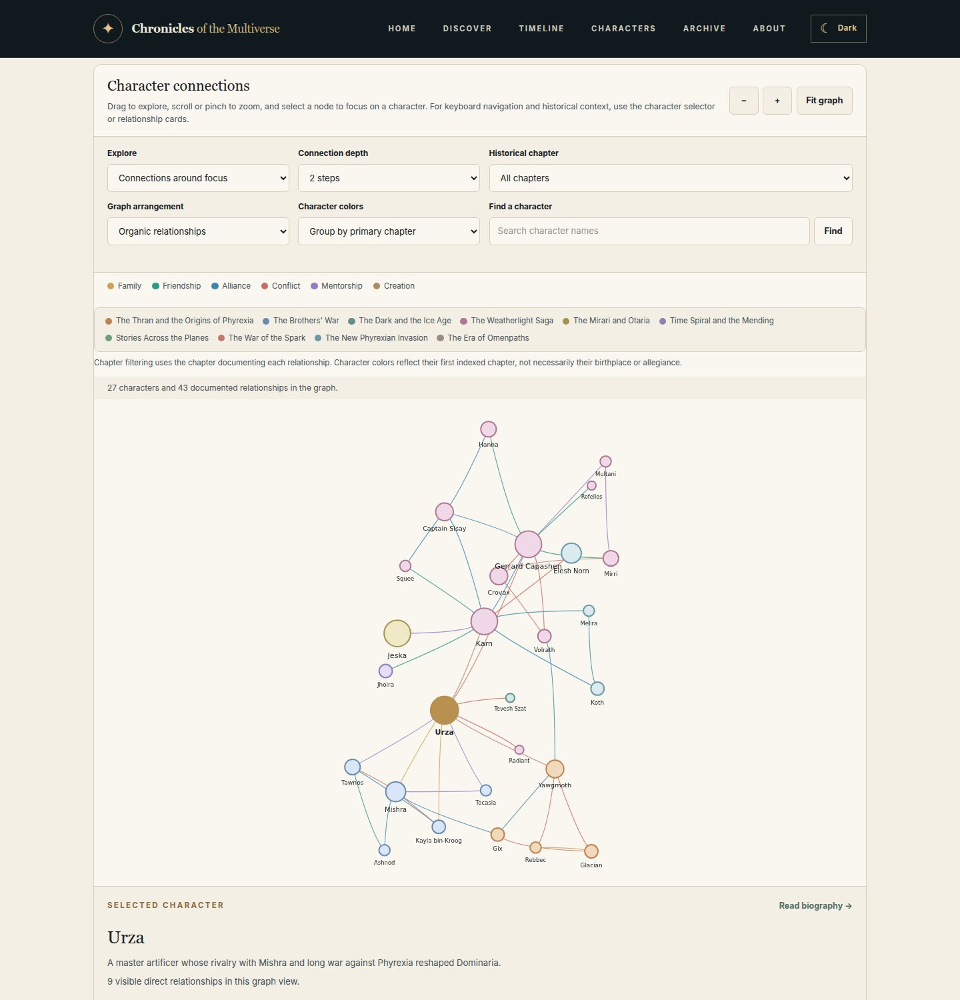
</p>

The **[relationship explorer](https://devisola.github.io/mtg-history/relationships/?person=urza)** maps 118 documented links between 88 characters: family, friendship, alliance, conflict, mentorship and creation. You can focus on one person and expand one to three steps out, filter by chapter, cluster by era or search for a name. The view is shareable as a URL, and an accessible card list mirrors the graph.

<table>
<tr>
  <td width="50%">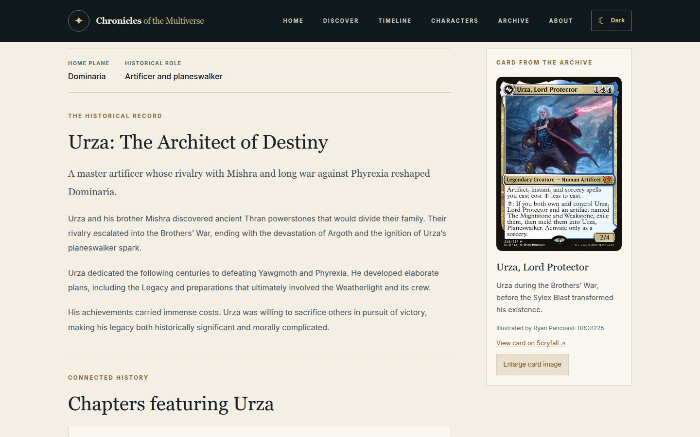</td>
  <td width="50%">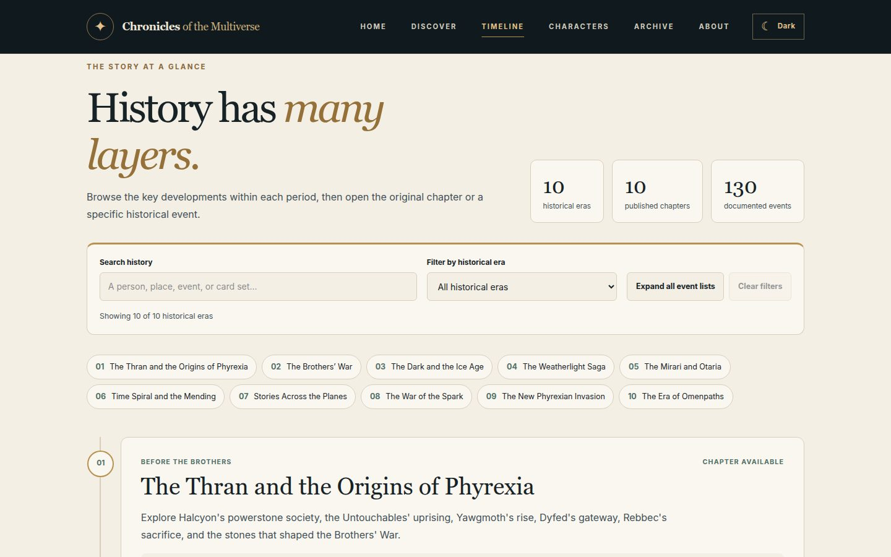</td>
</tr>
<tr>
  <td><strong><a href="https://devisola.github.io/mtg-history/characters/">Character profiles</a>.</strong> Each profile has a biography, the chapters and events the character appears in, and a featured card portrait.</td>
  <td><strong><a href="https://devisola.github.io/mtg-history/timeline/">Timeline atlas</a>.</strong> Ten eras in story order, each with its story period, publication history and 130 events, which you can search and filter.</td>
</tr>
<tr>
  <td>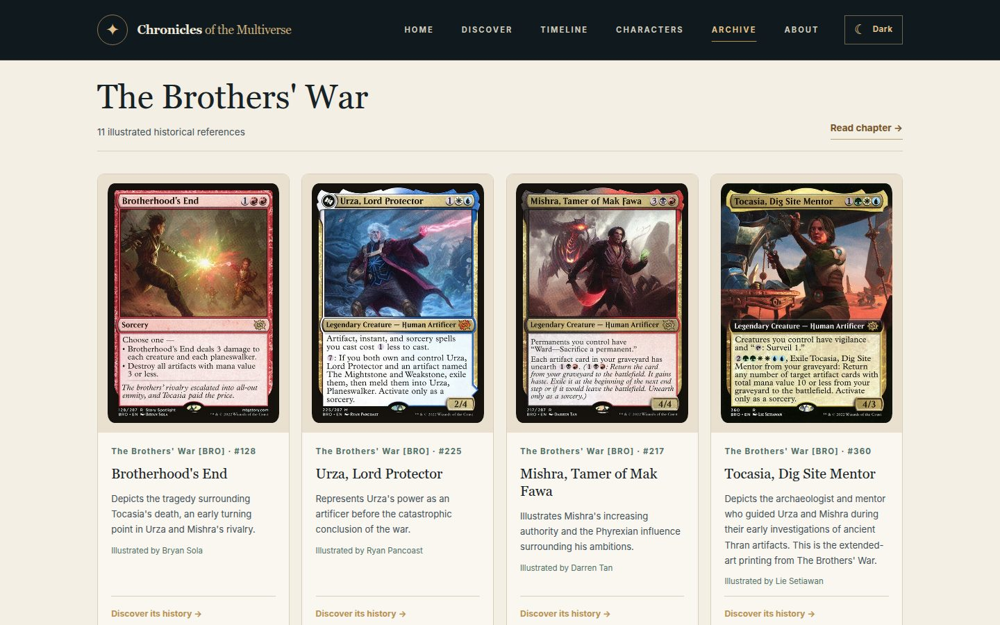</td>
  <td>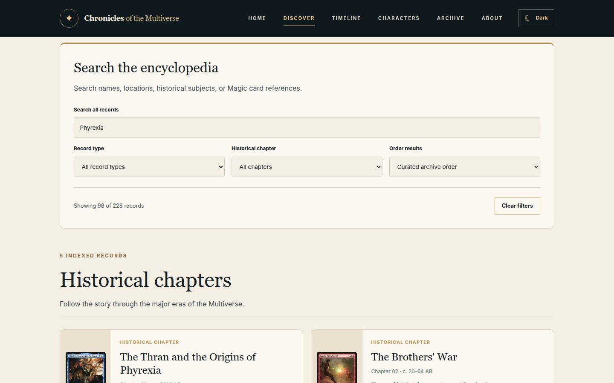</td>
</tr>
<tr>
  <td><strong><a href="https://devisola.github.io/mtg-history/archive/">Illustrated archive</a>.</strong> Every card reference, grouped by chapter, filterable by chapter, set and search, in gallery or compact view.</td>
  <td><strong><a href="https://devisola.github.io/mtg-history/discover/">Discovery</a>.</strong> One searchable index of 228 chapters, characters and events.</td>
</tr>
</table>

### At night, and on the go

<table>
<tr>
  <td width="64%">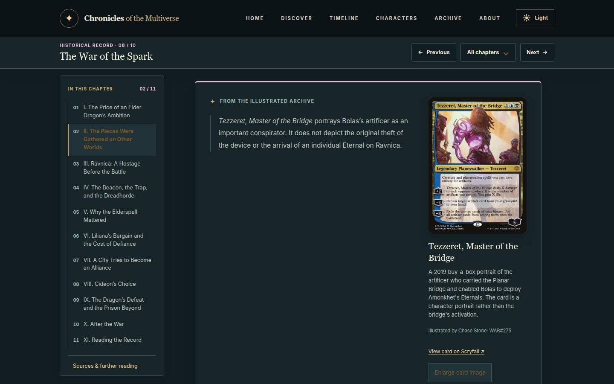</td>
  <td width="18%">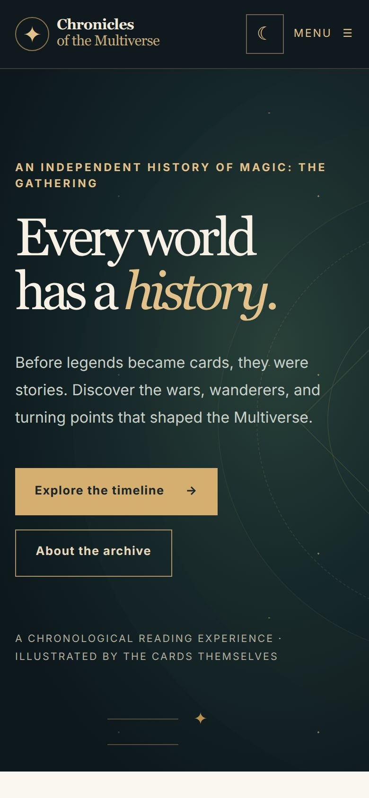</td>
  <td width="18%">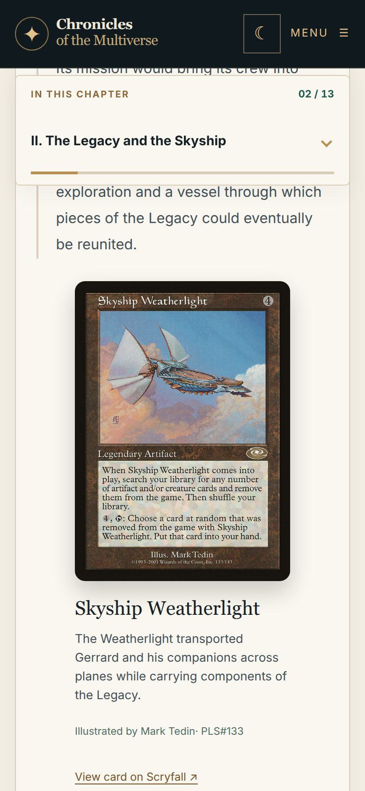</td>
</tr>
<tr>
  <td><strong>Light and dark themes.</strong> Your choice is remembered, and the default follows your system setting.</td>
  <td colspan="2"><strong>Mobile first.</strong> A collapsible table of contents, touch-friendly controls and full-width cards.</td>
</tr>
</table>

### Two chronologies, one story

> **Story chronology** tracks when an event took place _inside_ the fictional Multiverse. **Publication chronology** tracks when Magic players first encountered, or later revisited, that event.

The Brothers' War, for example, appeared through the artifacts of _Antiquities_ (1994), was developed extensively in fiction, and returned in _The Brothers' War_ (2022). Our chapters connect those perspectives without confusing release dates with in-world history.

## How a chapter is built

Each article aims to provide:

1. **Historical context** — what led to the event and why it matters.
2. **The narrative** — key people, places, conflicts, and consequences.
3. **Illustrated evidence** — a small, carefully chosen selection of relevant cards.
4. **Publication history** — expansions and stories that reveal or revisit the event.
5. **Sources and connections** — references, uncertainties, and links to related chapters.

The writing is original. Official lore is prioritized, and retcons or uncertain chronology are identified rather than quietly presented as settled fact.

## Behind the archive

|                     |                                            |
| :------------------ | :----------------------------------------- |
| **Framework**       | [Astro](https://astro.build/) + TypeScript |
| **Styling**         | Dart Sass / Astro-scoped SCSS and design tokens |
| **Content**         | MDX and typed Astro Content Collections (cards, characters, events, relationships, glossary) |
| **Package manager** | pnpm                                       |
| **Hosting**         | GitHub Pages                               |
| **Deployment**      | GitHub Actions, with Playwright and content integrity checks |

This is a statically generated site: no accounts, database, or application server are required.

### Run locally

Requires **Node.js 22.12+**, **pnpm**, and Git.

```bash
git clone https://github.com/DevIsola/mtg-history.git
cd mtg-history
pnpm install
pnpm dev
```

With Astro's configured base path, open `http://localhost:4321/mtg-history/`.

```bash
pnpm run verify               # Unit, content, editorial, type, build and link gates
pnpm exec playwright test     # Desktop and mobile Chromium regression tests
pnpm preview                  # Preview the production build
```

Pushing a reviewed change to `main` triggers the existing GitHub Pages deployment workflow. The application stays static and does not rehost Scryfall card artwork.

### Screenshot workflow

The tour above is reproducible. [`tests/screenshots/readme.spec.mjs`](tests/screenshots/readme.spec.mjs) builds the production site and puts each feature into a meaningful state: a card moment in view, the artwork viewer open, a definition expanded, the graph focused on Urza, and so on. It then captures desktop (1440 px wide) and phone (390 px at 2×) views in Chromium with reduced motion. **A capture fails rather than saving a screenshot with a missing or broken card image.**

- **On GitHub:** pushing a branch that changes the capture spec runs the [README screenshots workflow](.github/workflows/readme-screenshots.yaml), which commits the refreshed images back to that branch. You can also start it manually from the Actions tab.
- **Locally:**

  ```bash
  pnpm exec playwright install chromium
  pnpm run screenshots:readme   # writes docs/screenshots/*.jpg
  ```

Recapture after any visual change. Card imagery belongs to its artists and rights holders; the screenshots document the site's features and are not an artwork library. See [docs/readme-screenshots.md](docs/readme-screenshots.md) for the full checklist.

## Current chapter of the project

**Under active development.** The timeline and chapter system establish the reading experience; historical articles, imagery, source references, and cross-links are being expanded incrementally.

Ten published chapters currently span the ancient Thran, the Brothers' War, Dominaria's Ice Age, the Weatherlight and Otaria eras, the Mending, stories across other worlds, the War of the Spark, March of the Machine, and the Omenpaths era.

| Chapters | Characters | Events | Relationships | Card printings | Glossary terms |
| :------: | :--------: | :----: | :-----------: | :------------: | :------------: |
| 10       | 88         | 130    | 118           | 133            | 10             |

Cards, characters, events, relationships and glossary terms are typed content collections. The engineering pipeline checks artwork fidelity, source provenance and accessible interactions. Editorial depth and coverage keep growing.

## Support the archive

Chronicles of the Multiverse is a free, independent fan project
created and maintained by DevIsola.

If you enjoy the historical research, original writing, and
development that goes into this archive, you can support my work
through Ko-fi.

Your support helps me dedicate more time to expanding the
chapters, improving the reading experience, and maintaining
the project.

**Donations are entirely optional. All historical content
remains free to read and explore.**

<p align="center">
  <a href="https://ko-fi.com/B1H328PBAR">
    
  </a>
</p>

## Curated by DevIsola

Created and maintained by **[DevIsola](https://github.com/DevIsola)** as an independent, open-source tribute to the storytelling of Magic: The Gathering.

[Visit the live archive](https://devisola.github.io/mtg-history/) · [Explore the source](https://github.com/DevIsola/mtg-history)

---

<sub>**Unofficial fan-content notice.** This project is not affiliated with, sponsored, endorsed, or approved by Wizards of the Coast. Magic: The Gathering, its characters, settings, card art, and associated marks belong to their respective rights holders. This non-commercial archive uses original writing and original decorative README artwork and screenshots of the published site. Card images displayed within screenshots remain the property of their respective rights holders. See the <a href="https://company.wizards.com/en/legal/fancontentpolicy">Wizards of the Coast Fan Content Policy</a>.</sub>
